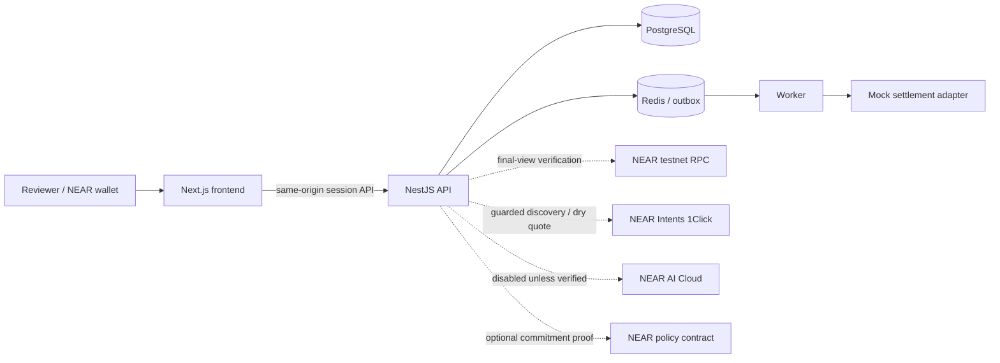

# Coffer demo script and evidence map

This script uses synthetic data and defaults to `SETTLEMENT_MODE=mock` and
`LIVE_TRANSFERS_ENABLED=false`. Do not enter payroll PII, fund a wallet, deploy
a contract, or enable a live provider for this demo.

## Architecture shown to reviewers



Solid arrows are the default local path. Dotted integrations are guarded,
fail-closed, and must not be described as live unless their retained evidence
is shown.

## Reproducible local start

Use the repository onboarding instructions and environment examples first.
Then, from the repository root:

```sh
docker compose up -d postgres redis
pnpm --dir backend prisma:migrate:deploy
pnpm --dir backend prisma:seed
pnpm --dir backend dev
pnpm --dir backend dev:worker
pnpm --dir frontend dev
```

The seed is idempotent and creates only synthetic roles, one issued invoice,
and one uncertain mock settlement. Payroll is intentionally imported through
the authenticated synthetic CSV flow. To reset an explicitly confirmed local,
non-production database:

```sh
CONFIRM_LOCAL_DB_RESET=yes pnpm --dir backend prisma:reset:local
```

The public visual walkthrough starts at `/demo/overview`. Canonical routes use
a backend-issued session from a fresh NEP-413 signature.

## Seven-minute narrative

1. **Truth boundary (30 s):** open the landing page, choose the no-wallet demo,
   and point out `DEMO MODE`, `Synthetic UI data`, and `No funds move`.
2. **J-01 invoice (75 s):** show the invoice shape, then use the retained
   canonical Playwright/API evidence for quote review, mock authorization,
   reconciliation, and the rule that only verified settlement can mark paid.
3. **J-02 CFO proposal (60 s):** show scoped evidence, an exact maximum, typed
   allocation output, and the human reserve action. State that the demo is
   deterministic and that live NEAR AI attestation is unavailable.
4. **J-03 bounded agent purchase (75 s):** show the vendor allowlist, exact
   mock asset, per-purchase/rolling limits, offer digest, distinct approval,
   and mock fulfillment. Show the over-limit/adversarial denial test result.
5. **J-04 shared treasury (75 s):** propose the 50/30/20 split, show immutable
   revisions and two distinct human approvals, then explain that quorum creates
   an internal reservation and never authorizes an automatic payout.
6. **J-05 synthetic payroll (75 s):** import only synthetic CSV, show encrypted
   batch review and self-only payslip evidence, then show deterministic fallback
   and the blocked private-AI state without claiming payout confidentiality.
7. **Recovery and audit (50 s):** open Activity, show unknown/refunded/pending
   states, queue an idempotent recheck, and state that queued is not settled.
   End on the API-unavailable sign-in recovery state.

## Evidence table

| Journey / track | UI evidence | Automated evidence | NEAR/provider evidence | Honest limitation |
| --- | --- | --- | --- | --- |
| J-01 invoice settlement | Canonical `/invoices` and `/pay/:token`; synthetic screenshot in `design/screenshots/invoices-*` | Frontend invoice settlement Playwright; backend invoice/payment HTTP E2E and reconciliation tests | Direct adapter verifies retained testnet evidence; 1Click remains guarded discovery/dry quote | Demo settlement is mock; no live payment occurs |
| J-02 AI CFO | Canonical `/cfo`; synthetic screenshot in `design/screenshots/cfo-*` | Typed-output, bounds, evidence, and adversarial-output tests | NEAR AI adapter exists behind verification gates | No live inference or TEE attestation was performed |
| J-03 agent commerce | Canonical `/agents`; synthetic screenshot in `design/screenshots/agents-*` | Offer binding, budget, quorum, denial, and mock fulfillment tests | No external vendor or chain transfer | Fulfillment and payment are mock |
| J-04 shared treasury | Canonical `/treasury` and `/approvals`; screenshots in `design/screenshots/{treasury,approvals}-*` | Digest/revision/quorum/reservation Playwright, API, and contract tests | Local contract artifacts and Sandbox evidence exist | Contract is undeployed; approvals are not fresh per-action wallet signatures |
| J-05 private payroll | Canonical `/payroll`; synthetic screenshot in `design/screenshots/payroll-*` | Tenant/role/self-only, encryption, manifest, and fail-closed private-AI tests | Verification state is exposed, never inferred | No real payroll, private inference, confidential payout, or transfer |
| Negative security / operations | Canonical `/activity`; screenshot in `design/screenshots/activity-*` | Unknown/refunded/underfunded, duplicate, idempotency, tenant denial, audit-chain, and recheck tests | Provider/RPC observations remain mocked unless separately evidenced | Local hash-chain evidence is not external notarization |

The complete accessibility audit is in `docs/design/f07-audit.md`. G5 owner
actions are tracked separately in `docs/submission-checklist.md`.
