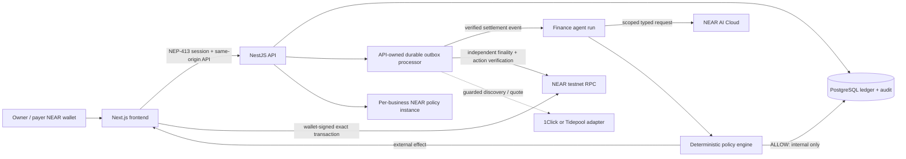

# Coffer autonomous-business demo script and evidence map

Status: Gate G4 is locally rehearsed with live NEAR testnet quorum evidence and
the honest private-AI fallback. Exact results are in `docs/g4-evidence.md`.
Use only synthetic business and payroll data. Do not claim verified private AI
unless a fresh recorded call passes every attestation and deployment check.

## The story

Coffer is the policy-controlled financial operating system that lets a business
safely delegate finance operations to AI agents on NEAR. A customer payment is
not the end of the workflow: verified settlement starts a bounded finance-agent
run that reads authorized evidence, requests verified private inference,
applies deterministic policy, performs safe internal allocations, requests an
exact wallet signature for any external transfer, and reconciles the result.

```text
Earn -> observe -> decide -> constrain -> act -> reconcile -> adapt
```

The model never receives a signing key, cannot change policy, and cannot turn
its own output into permission. External funds move only after an authorized
wallet signs the exact reviewed transaction.

## Architecture shown to reviewers



PostgreSQL remains authoritative for the off-chain ledger and agent-run state.
The API process owns durable polling and reconciliation; no separately deployed
worker is required. The policy contract records commitments and quorum but does
not custody funds. Tidepool is testnet routing evidence, not 1Click mainnet.

## Reproducible local start

From the repository root:

```sh
nvm use
docker compose up -d postgres redis
pnpm db:migrate:deploy
pnpm db:seed:synthetic
pnpm dev
```

Open `http://localhost:3000`. `/overview` is the wallet-authenticated,
tenant-backed product. `/demo/overview` is a separate fictional visual
walkthrough and cannot prove the autonomous flow.

## Primary X video — 2 minutes 15 seconds

This cut stays below the standard X 140-second upload limit while leaving a few
seconds for encoding variance. Record it as edited segments; blockchain
finality does not need to happen in real time on camera.

1. **Problem and promise (0:00-0:12).** Show the landing page. Say: “Coffer is
   a NEAR-native financial operating system where AI proposes, policy
   constrains, wallets authorize and every external effect is reconciled.”
2. **Identity and business boundary (0:12-0:25).** Sign in with a testnet NEAR
   wallet and open the synthetic Northstar Studio workspace. State that NEP-413
   proves wallet ownership without moving funds and that every record is
   tenant-scoped.
3. **Earn and observe (0:25-0:55).** Create and issue a small native-NEAR
   testnet invoice. Open the hosted payer page, sign its exact transaction, then
   show the invoice becoming paid only after final RPC verification. Briefly
   show the explorer transaction.
4. **Decide and constrain (0:55-1:25).** Open the automatically created Finance
   Agent run. Show the triggering settlement evidence, typed proposal,
   supporting record IDs, policy version and exact digest. If the fresh NEAR AI
   proof is green, show its verified provider-TEE status. Otherwise show
   `verification unavailable`, say that private inference failed closed, and
   continue only with the deterministic policy demonstration.
5. **Act safely (1:25-1:48).** Show policy automatically reserving an allowed
   internal payroll/operations allocation. Then show an external payout or
   purchase as `READY_FOR_SIGNATURE`; the model cannot sign it. Approve only
   the exact wallet transaction if rehearsed successfully.
6. **Reconcile and adapt (1:48-2:05).** Show the final transaction observation,
   balanced ledger posting and completed agent-run timeline. Open Activity and
   show that unknown, failed and duplicate evidence do not become settled.
7. **Close (2:05-2:15).** Say: “Coffer lets a business automate its finance
   cycle without giving autonomous software unrestricted custody. Built at
   NEAR HACKATHON.” End on the product and repository URLs.

## Optional six-minute backup walkthrough

Use the longer recording for judges who want implementation detail:

1. wallet authentication, organization isolation and configured constraints;
2. invoice creation, wallet payment, explorer evidence and reconciliation;
3. the automatic `INVOICE_SETTLED` trigger and idempotent Finance Agent run;
4. verified NEAR AI inference if freshly proven, otherwise the fail-closed
   unavailable state, typed-output checks and prompt-injection rejection;
5. deterministic policy, journal-only autonomous allocation and exact money;
6. bounded seeded-vendor procurement with truthful prototype labeling;
7. synthetic encrypted payroll and self-only employee view;
8. per-business policy contract, two distinct approvals and immutable digest;
9. unknown/refund/retry recovery, audit timeline and emergency pause.

## Recording readiness gates

- [x] **AB-01 (local evidence):** one verified invoice settlement creates exactly one durable
  Finance Agent run; duplicate settlement events cannot create another.
- [x] **AB-02 (fail-closed fallback):** the official NEAR AI adapter requires
  provider-TEE verification and an approved deployment digest. The current
  recording must say verification is unavailable and make no private-AI claim.
  Replace this fallback with a verified result only after a fresh live proof.
- [x] **AB-03:** an `ALLOW` decision can perform only an internal balanced
  reservation automatically; no model output directly moves funds.
- [x] **AB-04:** every external transfer still requires an authorized wallet
  signature and independent finality/action verification.
- [x] **AB-05:** the agent purchase uses the seeded provider, remains within its
  allowlist and budget, and is described as prototype fulfilment rather than an
  external production marketplace.
- [x] **AB-06:** the run timeline exposes its trigger, objective, evidence,
  inference, policy decision, action digest and reconciliation result.
- [x] **G4 contract proof:** the immutable proposal was approved by
  `olymight.testnet` and `olumight.testnet`; the final contract state is
  `Approved`. Explorer links are recorded in `docs/g4-evidence.md`.
- [ ] The video contains no secret, wallet key, payroll PII, real customer data
  or unsupported privacy/custody claim.
- [ ] Every shown explorer link is rechecked for testnet, signer, recipient,
  asset, exact amount and finality.

If AB-01 through AB-06 are not all green, do not use the complete autonomous
loop narration. Present Coffer instead as a policy-controlled finance platform
with AI-assisted proposals and separately identify each missing step.

## Evidence map

| Proof | Required UI evidence | Automated / external evidence | Honest boundary |
| --- | --- | --- | --- |
| Verified revenue | Invoice, payer page, paid state and transaction hash | Direct NEAR testnet signer/receiver/amount/finality verification; T-PAY-06/10/11 | Testnet NEAR has no production monetary claim |
| Autonomous trigger | One Finance Agent run linked to one settled payment | Duplicate-event and transactional-outbox integration test | Event autonomy does not grant signing authority |
| AI-native decision | Typed allocation, evidence refs, provider-TEE status and approved deployment digest | T-AI-01–05 and live attestation evidence | No verified result means no private-AI claim |
| Policy-controlled action | `ALLOW`, `DENY` or `REQUIRES_APPROVAL`, policy version and digest | T-POL-01–06 and T-LED-01–07 | Automatic action is journal-only for the MVP |
| External execution | Exact wallet transaction and later verified observation | RPC/receipt reconciliation and replay protection | A human-controlled wallet signs every external transfer |
| Agent procurement | Allowlisted seeded offer, rolling budget, approval and fulfilment | T-AGT-01–06 | Seeded provider is not an open agent marketplace |
| Private payroll | Encrypted synthetic batch and self-only payslip | T-PRV-01–10 | No real payroll, tax or confidential public-chain payout claim |
| NEAR policy | Per-business instance, immutable proposal digest and distinct approvals | Deployed testnet factory/policy artifacts and contract tests | Contract commits policy evidence; it never holds treasury funds |

G5 publication and human-controlled actions remain in
`docs/submission-checklist.md`.
